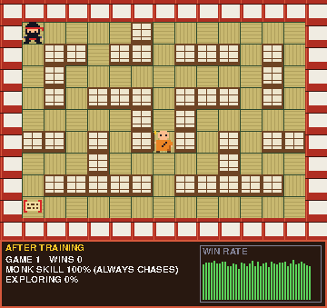
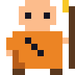
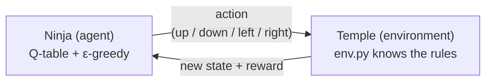

<div align="center">

# 🥷 Temple Dash

### A ninja that teaches itself to steal a sacred scroll, using reinforcement learning


*ADV CS III: Machine Learning and AI · Project 03: Reinforcement Learning PyGAIme*

| Before training | After training |
|:---:|:---:|
|  |  |
| Random moves. Caught by the monk almost immediately. | Reads the monk, picks the right route, grabs the scroll. |

</div>

The ninja starts out knowing **nothing**: not that walls block it, not that the scroll is the goal, not that the monk is dangerous. It only gets a reward number after each move. Through **Q-learning** it works out the rules and a winning strategy on its own, ending at **100% wins against a monk that always chases it**.

---

## Contents
- [Quick start](#-quick-start)
- [The game](#-the-game)
- [How the ninja learns](#-how-the-ninja-learns)
- [What makes it different](#-what-makes-it-different)
- [Results](#-results)
- [How the design evolved](#-how-the-design-evolved)
- [Testing](#-testing)
- [Project structure](#-project-structure)
- [Resources, collaboration and AI use](#-resources-collaboration-and-ai-use)

---

## 🚀 Quick start

```bash
pip install -r requirements.txt
python main.py --mode watch      # watch the trained ninja (press SPACE to fast-forward)
python main.py --fresh           # train a brand-new ninja from zero (press SPACE for turbo)
python main.py --mode play       # you are the monk: catch the ninja with the arrow keys
```

<details>
<summary><b>All modes and options</b></summary>

| Command | What it does |
|---|---|
| `python main.py` | Train with graphics, continuing from the saved brain |
| `python main.py --mode watch` | Watch the trained ninja; no learning |
| `python main.py --mode play` | You control the monk (arrow keys / WASD) |
| `python main.py --mode headless --episodes 5000` | Train as fast as possible with no window |
| `--fresh` | Ignore the saved brain and start from zero |
| `--rival learn` | The monk becomes a second Q-learning agent |
| `--skill 0.8` | Monk skill (0–1) for watch / play |
| `--seed 42` | Make a run repeatable |
| `python -m unittest tests -v` | Run the 14 unit tests |
| `python experiments.py` | Re-run the tuning experiments (~15 s) |

**Keys:** `SPACE` turbo (train / watch) · `S` save · `ESC` quit and save

</details>

---

## 🏯 The game

| | Character | Role |
|:---:|---|---|
|  | **Ninja** | The AI agent. Has to reach the scroll without being caught. |
|  | **Monk** | Guards the temple. Chases the ninja along the shortest path. |
|  | **Scroll** | The goal. Hidden in **one of 4 spots, chosen at random** each round. |

The temple is a 15×11 maze with tatami floors, shoji-screen inner walls and red-and-white outer walls. A round ends when the ninja grabs the scroll (**win**), the monk catches it (**loss**), or 150 moves pass (**timeout**). All the art is original 8-bit pixel art, drawn in code from text grids in `sprites.py`.

---

## 🧠 How the ninja learns

### The agent–environment loop



`env.py` is the only place the rules exist. `agent.py` only ever sees **states** and **rewards**.

### State: what the ninja sees
`(ninja_x, ninja_y, monk_dx, monk_dy, scroll_spot)`

| Part | Values | Why it's there |
|---|---|---|
| `ninja_x, ninja_y` | its square in the maze | to learn the layout and the routes |
| `monk_dx, monk_dy` | the monk's position **relative** to the ninja, capped at ±3 | to dodge. "Far away" all looks the same, which keeps the table small |
| `scroll_spot` | 0–3 | which hiding spot to head for this round |

That's 76 floor squares × 7 × 7 × 4 ≈ **14,900 possible states**, of which about **6,100** actually come up. That's small enough to store every one in a table.

### Actions
`UP` · `DOWN` · `LEFT` · `RIGHT`. Moving into a wall wastes the turn.

### Rewards: the only feedback the ninja gets
| Event | Reward | Purpose |
|---|---:|---|
| Each move | −1 | makes it hurry instead of wandering |
| Bumping a wall | −5 | helps it discover walls exist |
| Grabbing the scroll | **+100** | the goal |
| Caught by the monk | **−100** | the danger |

### The learning rule: Q-learning

$$Q(s,a) \leftarrow Q(s,a) + \alpha \left[ r + \gamma \max_{a'} Q(s',a') - Q(s,a) \right]$$

**In plain English:** *Q(s, a)* is the ninja's guess of "how good is this move here?" After every move it compares that guess with what actually happened: the reward it got, plus the best it thinks it can do from where it landed. Then it nudges the guess toward that.

| Setting | Value | Why |
|---|---|---|
| α (learning rate) | 0.2 | how big each nudge is; 0.05 learned too slowly (90% vs 100% test wins) |
| γ (discount) | 0.95 | the scroll can be 20+ moves away, so future rewards must still count; 0.5 did worse |

**Why a Q-table instead of a neural network (DQN)?** The state is small and made of whole numbers, so a table holds every situation, learns in seconds, and can be inspected: print `Q(state)` to see exactly why the ninja chose a move. A neural network would only add training time.

**Timeouts are handled correctly.** Only grabbing the scroll or being caught is a real ending. When a game is cut off at 150 moves, the update still counts the future value, because the ninja's position wasn't worthless; the game just stopped.

### Choosing moves: ε-greedy
With probability **ε** the ninja makes a random move (**explore**); otherwise it makes the move with the highest Q-value (**exploit**).

- ε starts at **1.0**. The ninja knows nothing, so exploring is the only way to find the scroll.
- After each game, ε is multiplied by **0.998**, so the ninja relies more on what it has learned.
- ε stops at **0.05**. A little exploring continues, so it can still find better routes.
- In watch mode and in testing, ε = 0.

---

## ✨ What makes it different

| Twist | What it does |
|---|---|
| 🎓 **Curriculum learning** | The monk starts at 30% skill. Each time the ninja wins 70% of its last 100 games, the monk gets 10% smarter, up to a perfect chaser. The challenge grows with the student. |
| 📜 **Moving goal** | The scroll hides in a random spot each round, so the ninja can't memorize a single path. |
| ⚔️ **Both sides learn** | With `--rival learn`, the monk is a second Q-learning agent, and the two adapt to each other like an arms race. |
| 🎮 **Human vs. AI** | `--mode play` lets a classmate play the monk against the trained ninja. |
| 🎨 **Original 8-bit art** | Every sprite and tile is drawn in code. No image files. |

---

## 📈 Results


**The trained ninja wins 100% of test games against a monk that always chases it.** The training curve levels off around 78% only because the ninja still makes 5% random moves while training. The final brain was trained for over 50 million games.

### Experiments: does each design choice actually matter?
`experiments.py` trains a new ninja under each design, 3 times each, against a perfect monk, then tests it in 1,000 games with exploration off.

| Design | Test win | Caught | Timeout | Games to reach 70% |
|---|:---:|:---:|:---:|:---:|
| **Baseline (the game's design)** | **100%** | 0% | 0% | 3,300 |
| No wall penalty | 100% | 0% | 0% | 3,400 |
| No step penalty | 85% | 7% | 9% | 5,800 (2 of 3 never) |
| Can't see the monk | 17% | 8% | 75% | never |
| Sees the monk only 1 square away | 100% | 0% | 0% | 2,833 |
| Can't see which spot has the scroll | 50% | 0% | 50% | never |
| γ = 0.5 | 97% | 2% | 1% | 4,200 |
| α = 0.05 | 90% | 0% | 10% | 5,433 |

### What I learned from them
- 👁️ **What the ninja can observe matters most.** Without seeing the monk it can't tell when it's safe to move, so it hides until time runs out (75% timeouts). Without knowing the scroll spot, it guesses and wins about half the time.
- ⏱️ **The step penalty is essential.** Without −1 per move, there's no reason to hurry, and the win rate drops to 85%.
- 🧱 **The wall penalty turned out unnecessary.** Bumping a wall already wastes a turn, and the step penalty already makes wasted turns cost something.
- 🔭 **Less vision learned faster here** (2,833 games), because it halves the number of states. I kept 3 squares because it helps against the random-wandering monk early in the curriculum.

Full numbers are in [`results/experiments.md`](results/experiments.md) and [`results/experiments.csv`](results/experiments.csv).

---

## 🔁 How the design evolved

| Version | Change | Result |
|:---:|---|---|
| 1 | Fixed scroll position, monk skill capped at 90% | ~94% wins after ~2,000 games |
| 2 | Monk raised to 100% skill (perfect chaser) | Harder, but still beatable |
| 3 | `--rival learn`: both sides learn | Win rate swings between ~60% and ~97%, an arms race |
| 4 | Scroll moves between 4 random spots | ~3.5× more states; needs ~4,000–6,000 games |
| 5 | Timeouts treated as "cut off", not as real endings | Correct Q-learning, checked by a unit test |
| 6 | Ran the 8-design experiment above | Confirmed the state design and step penalty; the wall penalty is optional |

---

## ✅ Testing

```bash
python -m unittest tests -v
```

The **14 unit tests** in [`tests.py`](tests.py) check:
- the maze: it loads, every scroll spot is reachable, and the monk's chase move really gets closer;
- the rules: wall bumps, grabbing the scroll, being caught (same square or walking through each other) and timeouts all give the right rewards;
- the state: the monk distance is capped correctly;
- the learning math: the Q-update matches the formula worked out by hand (0 + 0.5·(−1 + 0.9·10 − 0) = 4.0), terminal updates ignore the future, the greedy choice picks the best action, and ε stops at its floor.

---

## 🗂️ Project structure

```
├── main.py            TempleDash: game loop, modes, curriculum, stats, saving
├── env.py             TempleEnv: the RL environment (reset, step, states, rewards)
├── agent.py           QLearningAgent: Q-table, ε-greedy policy, learning update
├── maze.py            Maze: reads the ASCII map; BFS shortest paths for the monk
├── renderer.py        Renderer: draws the temple, characters and scoreboard
├── sprites.py         8-bit pixel art drawn from text grids
├── settings.py        every reward, hyperparameter, color and the maze layout
├── experiments.py     tuning experiments → results/
├── tests.py           14 unit tests
├── ninja_qtable.pkl   the trained ninja's Q-table
├── training_log.csv   training progress, one row per 100 games (made when you train)
├── results/           experiment tables, learning-curve chart, screenshot
├── docs/              GIFs and sprite images for this README
├── PRESENTATION.md    talk outline and Q&A prep
├── RUBRIC_CHECK.md    point-by-point check against the project rubric
└── AI_CHAT_LOGS.md    full conversation with the AI assistant
```

---

## 📚 Resources, collaboration and AI use

**Resources**
- The project brief's suggested reading on game AI and reinforcement learning *(list the specific links you read)*
- Sutton & Barto, *Reinforcement Learning: An Introduction* (2nd ed.), chapter 6: Q-learning and ε-greedy
- [Pygame documentation](https://www.pygame.org/docs/)

**Collaboration**
Individual project by *(your name)*. *(List any classmates who helped and how. No code was shared with classmates.)*

**AI use (DA Honor Code)**
This project was built with help from **Claude (Anthropic)**, an AI coding assistant, through Claude Code. Every code file has an "AI assistance" note at the top, and the full conversation is in [`AI_CHAT_LOGS.md`](AI_CHAT_LOGS.md).

- **What the AI did:** brainstormed game ideas; wrote the first version of every file; made the changes I asked for (the temple look, the samurai changed to a monk, red-and-white walls, the moving scroll, turbo in watch mode); suggested the curriculum, both-sides-learn and human-vs-AI twists; and added the unit tests, the experiments, the timeout fix and the documentation after a rubric review.
- **What I did:** chose the game, the theme and every design change; ran, trained and tested the game; trained the final ninja. *(Add what you changed or tuned yourself and what you learned in order to understand the code.)*
