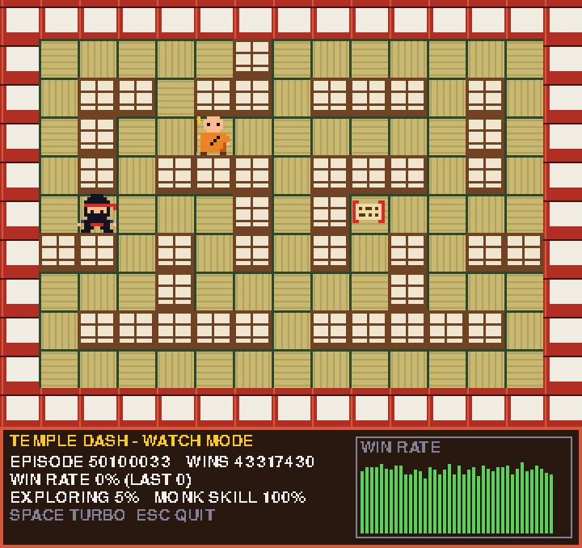
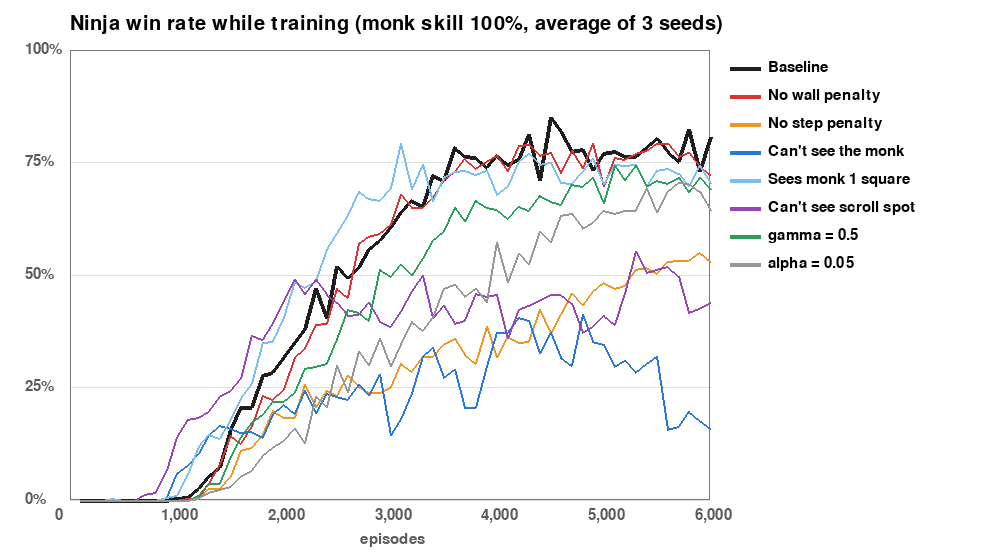

# Temple Dash 🥷 vs 🧘

**ADV CS III: Machine Learning and AI · Project 03: Reinforcement Learning PyGAIme**

An 8-bit Pygame game where a **ninja learns by reinforcement learning** to steal a secret scroll from a temple while a **monk** hunts it down. The ninja starts out knowing **nothing about the rules**. It doesn't know walls block it, that the scroll matters, or that the monk is dangerous. It only gets a reward number after each move, and with **Q-learning** it works out the rules and a winning strategy by itself.



---

## 1. Project objective: the problem the agent solves

Each round, the scroll is hidden in one of 4 spots in a temple maze. The ninja must reach it **without being caught**, while a monk chases it along the shortest path. To win, the ninja has to learn three things on its own:

1. **The layout:** where the walls are and how to get to each hiding spot.
2. **Where to go:** a different route for each of the 4 scroll spots.
3. **How to survive:** reading where the monk is and steering around it.

Nobody programs these rules into the ninja. They're only in the environment (`env.py`), and the ninja discovers them from rewards.

---

## 2. How to run

Requires Python 3.10+ and pygame.

```bash
pip install -r requirements.txt

python main.py                                  # train with graphics (SPACE = turbo)
python main.py --fresh                          # train a brand-new ninja from zero
python main.py --mode watch                     # watch the trained ninja (no learning)
python main.py --mode play                      # YOU are the monk: arrow keys / WASD
python main.py --mode headless --episodes 5000  # train fast with no window

python -m unittest tests -v                     # run the 14 unit tests
python experiments.py                           # re-run the tuning experiments (~15 s)
```

| Option | What it does |
|---|---|
| `--fresh` | Throw away the saved brain and start from zero |
| `--rival learn` | The monk becomes a second Q-learning agent (both sides learn) |
| `--skill 0.8` | Monk skill (0–1) for watch / play mode |
| `--seed 42` | Make a run repeatable |

**Keys:** `SPACE` turbo on/off (train and watch) · `S` save · `ESC` quit (auto-saves)

The trained brain is in `ninja_qtable.pkl`. Training progress is logged to `training_log.csv`, one summary row per 100 episodes.

---

## 3. Reinforcement learning design

### Agent–environment loop
```
 state ──► ninja (Q-table) picks an action ──► TempleEnv.step(action)
   ▲                                               │
   └──────────── new state, reward, done ◄─────────┘
```
`env.py` is the **environment** and knows the rules. `agent.py` is the **agent** and only ever sees states and rewards. `main.py` runs the loop.

### State space: what the ninja observes
`(ninja_x, ninja_y, monk_dx, monk_dy, scroll_spot)`

| Part | Values | Why it's there |
|---|---|---|
| `ninja_x, ninja_y` | its square in the 15×11 maze | to learn the layout and routes |
| `monk_dx, monk_dy` | monk's position **relative** to the ninja, clipped to ±3 | to dodge; "far away" all looks the same, which keeps the table small |
| `scroll_spot` | 0–3: which hiding spot has the scroll | a different route for each spot |

Possible states: 76 floor squares × 7 × 7 offsets × 4 spots ≈ 14,900. Only about 6,100 ever actually come up. That's small enough for a plain table.

**Evidence that every part is needed** (see section 5): with the monk offset removed, the ninja wins only **17%** of games. With the scroll spot removed, it wins **50%**.

### Action space
`UP, DOWN, LEFT, RIGHT`. Moving into a wall wastes the turn.

### Reward function
| Event | Reward | Why |
|---|---|---|
| Each move | −1 | Makes it hurry. Without it, the test win rate drops from 100% to 85% (section 5) |
| Walk into a wall | −5 | So it learns walls exist. The experiments showed this one is optional, see below |
| Grab the scroll | +100 | The goal |
| Caught by the monk | −100 | The danger |

### Learning algorithm: tabular Q-learning
```
Q(s,a) ← Q(s,a) + α · [ r + γ · max Q(s',a') − Q(s,a) ]
```
- **α = 0.2** (learning rate). α = 0.05 learned too slowly: 90% vs 100% test wins.
- **γ = 0.95** (discount). The scroll can be 20+ moves away, so the ninja must value rewards in the future. With γ = 0.5 it wins only 97%, and learning is slower.
- **Timeouts are not real endings.** If a game is cut off after 150 moves, the update still adds `γ · max Q(s')`. Only grabbing the scroll or being caught is *terminal*. Treating a timeout as terminal would teach the ninja that its position there was worthless, which isn't true.

**Why Q-learning, and not a neural network (DQN)?** The state is small and made of whole numbers, so a table can hold every state. A table also learns in seconds and can be inspected directly: you can print `Q(state)` and see why the ninja chose a move. A neural network would add training time and complexity with no benefit for a maze this size.

### Action policy: ε-greedy
With probability ε the ninja moves randomly (**explore**), otherwise it takes the action with the highest Q-value (**exploit**). ε starts at 1.0 (completely random, since it knows nothing), is multiplied by 0.998 after every episode, and stops at 0.05.

- **Why ε-greedy:** early on, random moves are the only way to discover the scroll and the danger of the monk. Later, the ninja should use what it learned. Keeping 5% randomness lets it keep finding improvements.
- In **watch mode** and in the tests, ε = 0 (pure exploitation). That's why the test win rate (100%) is higher than the training curve (~78%): during training, 5% random moves sometimes walk it into the monk.

---

## 4. Creative twists (beyond a standard tutorial)

1. **Curriculum learning:** the monk starts at 30% skill (it chases 30% of the time and wanders otherwise). Each time the ninja wins 70% of its last 100 games, the monk gets 10% smarter, up to a perfect chaser at 100%.
2. **Moving objective:** the scroll is hidden in one of 4 random spots each round (the `$` squares in `settings.py`). The ninja can't memorize one path.
3. **Both sides learn** (`--rival learn`): the monk is its own Q-learning agent. The win rate swings back and forth as each side adapts, like an arms race.
4. **Human vs. AI** (`--mode play`): classmates can play the monk against the trained ninja.
5. **Original 8-bit art:** every sprite and tile is drawn from text grids in `sprites.py`, with no image files.

---

## 5. Training results and tuning

### Learning curves


### Experiments
`experiments.py` trains a new ninja under each design, 3 times each, against a **perfect monk** (skill 100%). It then tests each trained ninja in 1,000 games with exploration off.

| Design | Question | Test win | Caught | Timeout | Episodes to 70% | States |
|---|---|---|---|---|---|---|
| Baseline | the design used in the game | **100%** | 0% | 0% | 3,300 | 1,199 |
| No wall penalty | is the −5 for bumping walls needed? | **100%** | 0% | 0% | 3,400 | 1,011 |
| No step penalty | does −1 per move make it hurry? | **85%** | 7% | 9% | 5,800 (2 of 3 never) | 1,040 |
| Can't see the monk | how much does seeing the monk matter? | **17%** | 8% | 75% | never | 134 |
| Sees monk 1 square | smaller state: faster or worse? | **100%** | 0% | 0% | 2,833 | 633 |
| Can't see scroll spot | must it know where the scroll is? | **50%** | 0% | 50% | never | 373 |
| γ = 0.5 | only cares about the near future | **97%** | 2% | 1% | 4,200 | 1,445 |
| α = 0.05 | learns in smaller steps | **90%** | 0% | 10% | 5,433 | 1,233 |

### What the experiments taught me
- **The state matters most.** A ninja that can't see the monk gets stuck: it can't tell when it's safe to move, so it mostly hides until time runs out (75% timeouts). A ninja that doesn't know where the scroll is just guesses one spot, so it wins about half the time.
- **The step penalty matters.** Without −1 per move, there's no reason to hurry, so the ninja dawdles and gets caught or times out.
- **The wall penalty turned out unnecessary.** Bumping a wall already wastes a turn, and the step penalty already makes wasted turns cost something. I kept it because it helps early exploration slightly (3,300 vs 3,400 episodes to reach 70%), but it's a small effect.
- **Seeing only 1 square learns faster** (2,833 episodes) with the same final result against this monk, because the state space is half the size. Against the random-wandering monk early in the curriculum, more vision helps, so I kept 3.
- **α and γ:** the defaults (0.2 and 0.95) beat the alternatives.

### Development history (iteration log)
| Version | Change | Result |
|---|---|---|
| 1 | Fixed scroll position, monk skill capped at 90% | ~94% win rate after ~2,000 episodes |
| 2 | Monk skill raised to 100% (perfect chaser) | ~85% training win rate: harder but still beatable |
| 3 | Added `--rival learn` (both sides learn) | Win rate swings between ~60% and ~97% (arms race) |
| 4 | Scroll moves between 4 random spots, so the state gets a 5th number | Needs ~4,000–6,000 episodes instead of ~2,000 (about 3.5× more states) |
| 5 | Timeouts treated as cut-off, not terminal (correct Q-learning) | Cleaner value estimates; tested in `tests.py` |
| 6 | Ran `experiments.py` (above) to check every design choice | Confirmed the state and step penalty; found the wall penalty is optional |

---

## 6. Testing

`tests.py` has 14 unit tests (`python -m unittest tests -v`). They check:
- the maze loads, every scroll spot is reachable, and the monk's chase move really gets closer;
- wall bumps, grabbing the scroll, both ways of being caught (same square or walking through each other), and timeouts all give the right rewards;
- the state clips the monk distance correctly;
- the Q-learning update matches the formula by hand (for example, 0 + 0.5·(−1 + 0.9·10 − 0) = 4.0), terminal updates ignore the future, the greedy policy picks the best action, and ε stops at its floor.

---

## 7. Code structure

| File | Purpose |
|---|---|
| `main.py` | `TempleDash` class: game loop, modes, curriculum, stats, logging, saving |
| `env.py` | `TempleEnv` class: the RL environment (`reset`, `step`, states, rewards) |
| `agent.py` | `QLearningAgent` class: Q-table, ε-greedy policy, learning update |
| `maze.py` | `Maze` class: reads the ASCII map; BFS shortest paths for the monk's chase |
| `renderer.py` | `Renderer` class: draws the temple, sprites, HUD and win-rate graph |
| `sprites.py` | 8-bit pixel art defined as text grids |
| `settings.py` | Every reward, hyperparameter, color, and the maze layout |
| `experiments.py` | Tuning experiments: writes `results/` |
| `tests.py` | Unit tests |
| `ninja_qtable.pkl` | The trained ninja's Q-table (companion data) |
| `training_log.csv` | Training progress, one row per 100 episodes |
| `results/` | Experiment tables, learning-curve chart, screenshot |
| `AI_CHAT_LOGS.md` | Full chat with the AI assistant (honor code documentation) |
| `PRESENTATION.md` | Talk outline and Q&A prep |
| `RUBRIC_CHECK.md` | Point-by-point check against the project rubric |

---

## 8. Resources used

- The project brief's suggested reading on game AI and reinforcement learning *(list the specific links you actually read)*.
- Sutton & Barto, *Reinforcement Learning: An Introduction* (2nd ed.), chapter 6 (Q-learning and ε-greedy).
- Pygame documentation: https://www.pygame.org/docs/

---

## 9. Collaboration

Individual project by *(your name)*. *(List any classmates who helped and how. Per the honor code, no code was shared with classmates.)*

---

## 10. AI use (DA Honor Code)

This project was built with help from **Claude (Anthropic)**, through Claude Code, an AI coding assistant. Every code file also has an "AI assistance" note at the top, and the **full conversation is in [`AI_CHAT_LOGS.md`](AI_CHAT_LOGS.md)**.

**What the AI did:**
- Brainstormed game ideas with me. I chose a cat-and-mouse maze, then made it 8-bit with a ninja, a monk and a temple.
- Wrote the first version of every file: the environment, the Q-learning agent, the game loop, the pixel-art sprites and the HUD.
- Made changes I asked for: the temple and tatami look, the samurai changed to a monk, red-and-white walls, the moving scroll, and turbo in watch mode.
- Suggested the curriculum, both-sides-learn and human-vs-AI twists.
- Reviewed the project against the rubric and added the unit tests, the experiments script, the correct timeout handling and this README.

**What I did:**
- Chose the game, the theme and every design change.
- Ran, trained and tested the game; I trained the final ninja myself.
- *(Add: what you changed or tuned yourself, what you had to learn to understand the code, and your own experiments.)*

**How I made sure I understand it:** *(e.g. walked through `env.step` and `agent.learn` line by line, checked the Q-update math in `tests.py` by hand.)*

---

## 11. Submission checklist
- [ ] Repo pushed to GitHub with all code, `ninja_qtable.pkl`, `training_log.csv` and `results/`
- [ ] `juliancochran` added as a collaborator
- [ ] Regular commits throughout development (not one big upload)
- [ ] Repo link submitted through Veracross
- [ ] Sections 8–10 filled in with my own details
