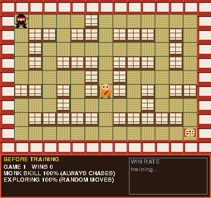
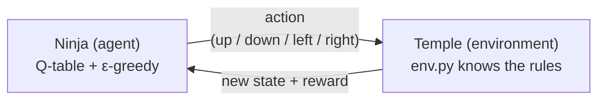

<div align="center">

# Temple Dash

**A ninja learns to steal a scroll from a temple using Q-learning.**


ADV CS III: Machine Learning and AI, Project 03 (Reinforcement Learning PyGAIme)

| Before training | After training |
|:---:|:---:|
|  |  |
| Moves at random and gets caught within a few seconds. | Waits for the monk, takes the right route, gets the scroll. |

</div>

The ninja starts with an empty Q-table. Nobody tells it that walls block it, that the scroll is the goal, or that the monk is dangerous. All it gets back after each move is a reward number. After training it wins 100% of test games against a monk that always chases it.

## Contents
- [Quick start](#quick-start)
- [The game](#the-game)
- [How the ninja learns](#how-the-ninja-learns)
- [Extras beyond the basic assignment](#extras-beyond-the-basic-assignment)
- [Results](#results)
- [How the design changed](#how-the-design-changed)
- [Testing](#testing)
- [Project structure](#project-structure)
- [Resources, collaboration and AI use](#resources-collaboration-and-ai-use)

## Quick start

```bash
pip install -r requirements.txt
python main.py --mode watch      # watch the trained ninja (SPACE fast-forwards)
python main.py --fresh           # train a new ninja from zero (SPACE for turbo)
python main.py --mode play       # you play the monk with the arrow keys
```

If you only try one thing, try `--fresh` and press SPACE after about ten seconds. You see the random wandering first, then the win rate bars climb.

<details>
<summary>All modes and options</summary>

| Command | What it does |
|---|---|
| `python main.py` | Train with graphics, continuing from the saved brain |
| `python main.py --mode watch` | Watch the trained ninja (no learning) |
| `python main.py --mode play` | You control the monk (arrow keys or WASD) |
| `python main.py --mode headless --episodes 5000` | Train as fast as possible with no window |
| `--fresh` | Ignore the saved brain and start from zero |
| `--rival learn` | The monk becomes a second Q-learning agent |
| `--skill 0.8` | Monk skill from 0 to 1 in watch or play mode |
| `--seed 42` | Make a run repeatable |
| `python -m unittest tests -v` | Run the 14 unit tests |
| `python experiments.py` | Rerun the tuning experiments (about 15 seconds) |

Keys: SPACE turns turbo on and off (train and watch), S saves, ESC quits and saves.

</details>

## The game

| | Character | Role |
|:---:|---|---|
|  | Ninja | The agent. It has to reach the scroll without getting caught. |
|  | Monk | Guards the temple and chases the ninja along the shortest path. |
|  | Scroll | The goal. Each round it's hidden in one of 4 spots, picked at random. |

The temple is a 15 by 11 maze with tatami floors, shoji screens for the inner walls, and red and white outer walls. A round ends when the ninja grabs the scroll (a win), the monk catches it (a loss), or 150 moves go by (a timeout). I drew all the sprites as text grids in `sprites.py`, so the game has no image files.

## How the ninja learns

### The loop



The rules only exist in `env.py`. The agent in `agent.py` never sees them. It only gets states and rewards.

### State

The ninja sees five numbers: `(ninja_x, ninja_y, monk_dx, monk_dy, scroll_spot)`.

| Part | Values | Why I included it |
|---|---|---|
| `ninja_x, ninja_y` | its square in the maze | so it can learn the layout and the routes |
| `monk_dx, monk_dy` | where the monk is compared to the ninja, capped at 3 squares each way | so it can dodge. Anything farther than 3 looks the same, which keeps the table small |
| `scroll_spot` | 0 to 3 | so it knows which hiding spot to go to this round |

The maze has 76 floor squares, so there are 76 × 7 × 7 × 4, about 14,900, possible states. Only about 6,100 of them ever come up in practice. A table can hold all of those easily.

### Actions

Up, down, left or right. Walking into a wall wastes the turn.

### Rewards

| Event | Reward | Why |
|---|---:|---|
| Each move | −1 | so it hurries instead of wandering |
| Bumping a wall | −5 | so it finds out walls exist |
| Grabbing the scroll | +100 | the goal |
| Getting caught | −100 | the danger |

### The update rule

$$Q(s,a) \leftarrow Q(s,a) + \alpha \left[ r + \gamma \max_{a'} Q(s',a') - Q(s,a) \right]$$

Q(s, a) is the ninja's guess at how good a move is in a given spot. After each move it compares the guess with what happened: the reward it just got, plus the best value it expects from the square it landed on. Then it moves the guess part of the way toward that.

| Setting | Value | Why |
|---|---|---|
| α (learning rate) | 0.2 | how far each update moves the guess. 0.05 learned too slowly (90% test wins instead of 100%) |
| γ (discount) | 0.95 | the scroll can be 20 or more moves away, so later rewards still have to count. 0.5 did worse |

I used a table instead of a neural network (DQN) because the state is small and made of whole numbers. The table fits every state, trains in seconds, and I can print `Q(state)` to see why the ninja picked a move. A neural network would just make training slower here.

Timeouts get special handling. Grabbing the scroll and getting caught are real endings, so nothing comes after them. A timeout only means the game was cut off at 150 moves. The ninja's position wasn't worthless, so the update still adds the future value.

### Picking moves (ε-greedy)

With probability ε the ninja makes a random move. Otherwise it picks the move with the highest Q-value. ε starts at 1.0 because at the start random moves are the only way to find the scroll at all. After every game ε is multiplied by 0.998, and it stops dropping at 0.05, so the ninja keeps trying something new now and then. Watch mode and the tests use ε = 0.

## Extras beyond the basic assignment

The monk gets harder as the ninja improves. It starts at 30% skill, meaning it chases 30% of the time and wanders the rest. Every time the ninja wins 70% of its last 100 games, the monk gets 10% better, until it chases every move.

The scroll moves. Because it's hidden in a random spot each round, the ninja can't just memorize one path.

Both sides can learn. With `--rival learn` the monk is a second Q-learning agent. The win rate swings back and forth as each one adapts to the other.

You can play against it. `--mode play` puts a person in control of the monk.

## Results


The trained ninja wins 100% of test games against a monk that always chases. During training the curve stays around 78%, because the ninja is still making 5% random moves and some of those walk it into the monk. The brain in this repo was trained for over 50 million games.

### Experiments

`experiments.py` trains a new ninja for each design below, three times each, against a monk at 100% skill. It then tests each one in 1,000 games with exploring turned off.

| Design | Test win | Caught | Timeout | Games to reach 70% |
|---|:---:|:---:|:---:|:---:|
| Baseline (the design the game uses) | 100% | 0% | 0% | 3,300 |
| No wall penalty | 100% | 0% | 0% | 3,400 |
| No step penalty | 85% | 7% | 9% | 5,800 (2 of 3 runs never got there) |
| Can't see the monk | 17% | 8% | 75% | never |
| Sees the monk only 1 square away | 100% | 0% | 0% | 2,833 |
| Doesn't know which spot has the scroll | 50% | 0% | 50% | never |
| γ = 0.5 | 97% | 2% | 1% | 4,200 |
| α = 0.05 | 90% | 0% | 10% | 5,433 |

What the ninja can see mattered more than anything else. Without the monk's position it can't tell when it's safe to move, so it mostly hides until the clock runs out (75% timeouts). Without the scroll spot it guesses, and it wins about half the time.

The step penalty mattered too. Without the −1 per move it has no reason to hurry, and it dropped to 85%.

The wall penalty didn't matter. Bumping a wall already wastes a turn, and the step penalty already makes wasted turns cost something. I left it in because it made early learning a little faster (3,300 games versus 3,400), but that gap is small enough that it could just be noise across three runs.

Seeing only 1 square learned faster (2,833 games) because it cuts the number of states roughly in half. I kept 3 squares anyway, because the early, random-wandering monk is harder to read up close. I haven't tested that idea directly.

The full numbers are in [`results/experiments.md`](results/experiments.md) and [`results/experiments.csv`](results/experiments.csv).

## How the design changed

| Version | Change | Result |
|:---:|---|---|
| 1 | Scroll always in the same spot, monk capped at 90% skill | about 94% wins after about 2,000 games |
| 2 | Monk raised to 100% skill | harder, still beatable |
| 3 | Added `--rival learn` | win rate swung between about 60% and 97% |
| 4 | Scroll moves between 4 random spots | about 3.5 times as many states, so it needed 4,000 to 6,000 games |
| 5 | Timeouts no longer counted as real endings | correct Q-learning, and a unit test checks it |
| 6 | Ran the experiments above | confirmed the state design and the step penalty, and showed the wall penalty is optional |

## Testing

```bash
python -m unittest tests -v
```

There are 14 tests in [`tests.py`](tests.py). They check that the maze loads, that every scroll spot can be reached, and that the monk's chase move gets closer. They also check every reward: wall bumps, grabbing the scroll, getting caught on the same square or by swapping places, and timeouts. One checks that the monk distance is capped at 3. The rest check the math: the Q-update matches the formula worked out by hand (0 + 0.5 × (−1 + 0.9 × 10 − 0) = 4.0), a real ending ignores the future, the greedy choice picks the highest value, and ε stops at its minimum.

## Project structure

```
├── main.py            TempleDash: game loop, modes, curriculum, stats, saving
├── env.py             TempleEnv: the environment (reset, step, states, rewards)
├── agent.py           QLearningAgent: Q-table, ε-greedy policy, learning update
├── maze.py            Maze: reads the ASCII map, BFS shortest paths for the monk
├── renderer.py        Renderer: draws the temple, characters and scoreboard
├── sprites.py         pixel art drawn from text grids
├── settings.py        rewards, hyperparameters, colors and the maze layout
├── experiments.py     tuning experiments, writes to results/
├── tests.py           14 unit tests
├── ninja_qtable.pkl   the trained ninja's Q-table
├── training_log.csv   one row per 100 games (created when you train)
├── results/           experiment tables, learning curve chart, screenshot
├── docs/              GIFs and sprite images for this README
├── RUBRIC_CHECK.md    my check of the project against the rubric
└── AI_CHAT_LOGS.md    the full conversation with the AI assistant
```

## Resources, collaboration and AI use

### Resources
I read the links suggested in the project brief:
- [The Total Beginner's Guide to Game AI](https://www.gamedev.net/tutorials/programming/artificial-intelligence/the-total-beginners-guide-to-game-ai-r4942/) (GameDev.net)
- [Where would I start if I wanted to create an AI agent to play a 2D game?](https://ai.stackexchange.com/questions/39765/where-would-i-start-if-i-wanted-to-create-an-ai-agent-to-play-a-2d-game) (AI Stack Exchange)
- [Create Game AI in Python](https://reintech.io/blog/create-game-ai-python-tutorial) (Reintech)
- [Ultimate Guide for Reinforced Learning, Part 1: Creating a Game](https://towardsdatascience.com/ultimate-guide-for-reinforced-learning-part-1-creating-a-game-956f1f2b0a91/) (Towards Data Science)
- [Teach AI to Play Snake with Reinforcement Learning](https://www.python-engineer.com/posts/teach-ai-snake-reinforcement-learning/) (Python Engineer)

### Collaboration
Individual project by Ganapathi Pamula. No code was shared with classmates.

### AI use (DA Honor Code)
I built this with help from Claude (Anthropic), an AI coding assistant, through Claude Code. Every code file has an "AI assistance" note at the top, and the whole conversation is in [`AI_CHAT_LOGS.md`](AI_CHAT_LOGS.md).

Claude brainstormed game ideas with me and wrote the first version of every file. It made the changes I asked for: the temple look, swapping the samurai for a monk, the red and white walls, the moving scroll, and turbo in watch mode. It suggested the curriculum, the both-sides-learn mode, and the play mode. After checking the project against the rubric, it added the unit tests, the experiments, the timeout fix and the documentation.
